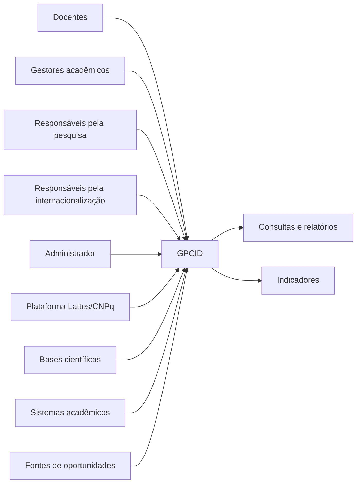

# ESPECIFICAÇÃO DE REQUISITOS DE SOFTWARE (SRS)

# Sistema de Gestão da Produção Científica e Internacionalização Docente (GPCID)

**Universidade de Fortaleza (Unifor)**

| Campo | Informação |
| --- | --- |
| Identificador | SRS-GPCID |
| Nome | Especificação de Requisitos de Software do GPCID |
| Versão | 0.1 |
| Data | 08/11/2026 |
| Documento de origem | Visão da Demanda (VD-GPCID), versão 1.1 |
| Situação | Rascunho para elicitação e validação |
| Responsável pela elaboração | Equipe do projeto — a identificar |
| Responsável pela aprovação | Representantes institucionais — a identificar |

* * *

# IDENTIFICAÇÃO E HISTÓRICO DE ALTERAÇÕES

## Histórico de versões

| Data | Versão | Descrição | Autor |
| --- | --- | --- | --- |
| 08/11/2026 | 0.1 | Elaboração inicial da especificação de requisitos com base na VD-GPCID 1.1. Estruturação dos requisitos funcionais, não funcionais, interfaces, restrições, rastreabilidade e verificação. | Equipe do projeto |

## Convenção de versionamento

O documento utilizará versionamento semântico adaptado à gestão dos requisitos:

-   **0.x:** versões preliminares em elaboração e elicitação.
-   **1.0:** primeira versão validada e aprovada institucionalmente.
-   **1.x:** revisões posteriores que não alterem substancialmente o escopo aprovado.
-   **2.0 ou superior:** revisões que introduzam alterações significativas no escopo ou nas capacidades aprovadas.

Toda alteração deverá ser registrada no histórico, identificando requisito afetado, justificativa, origem da solicitação, impacto e responsável pela aprovação.

* * *

# SUMÁRIO

1.  Introdução 1.1 Propósito 1.2 Escopo 1.3 Definições, acrônimos e abreviações 1.4 Referências 1.5 Organização do documento
2.  Descrição geral 2.1 Perspectiva do produto 2.2 Funções do produto 2.3 Classes e características dos usuários 2.4 Ambiente operacional 2.5 Restrições de projeto 2.6 Premissas e dependências 2.7 Distribuição e priorização dos requisitos
3.  Requisitos específicos 3.1 Interfaces externas 3.2 Requisitos funcionais 3.3 Requisitos de dados 3.4 Requisitos de desempenho 3.5 Restrições de projeto 3.6 Atributos de qualidade 3.7 Requisitos de segurança e privacidade 3.8 Requisitos de integração 3.9 Regras de negócio
4.  Requisitos de verificação e validação
5.  Rastreabilidade dos requisitos
6.  Apêndices
7.  Índice

* * *

# 1\. INTRODUÇÃO

## 1.1 Propósito

Este documento especifica os requisitos de software do Sistema de Gestão da Produção Científica e Internacionalização Docente (GPCID), proposto para a Universidade de Fortaleza (Unifor).

Seu propósito é estabelecer uma descrição organizada das capacidades, funcionalidades, interfaces, restrições e atributos de qualidade esperados para a solução.

A especificação deverá servir como referência para:

-   Identificação e validação das necessidades dos usuários e interessados.
-   Definição do escopo funcional e não funcional do sistema.
-   Modelagem dos casos de uso e processos.
-   Elaboração dos modelos de dados e interfaces.
-   Planejamento e execução do desenvolvimento.
-   Elaboração dos casos de teste e critérios de aceitação.
-   Acompanhamento da evolução dos requisitos.
-   Verificação da conformidade do software com as necessidades aprovadas.

Os requisitos apresentados são preliminares e deverão ser confirmados durante a elicitação com os representantes institucionais.

## 1.2 Escopo

O GPCID será uma solução destinada a organizar, consultar, acompanhar e analisar informações relacionadas à formação acadêmica, produção científica e internacionalização dos docentes da Universidade de Fortaleza.

O sistema deverá contemplar, conforme validação institucional:

1.  Consulta de informações curriculares e formação acadêmica.
2.  Consulta e acompanhamento da produção científica.
3.  Classificação de características de internacionalização das publicações.
4.  Consulta ao histórico da produção científica.
5.  Acompanhamento de colaborações acadêmicas e científicas.
6.  Registro e consulta de missões internacionais.
7.  Consulta e eventual cadastro de oportunidades científicas.
8.  Disponibilização de indicadores e relatórios.
9.  Configuração e versionamento de indicadores.
10.  Identificação de inconsistências e rastreabilidade das informações.
11.  Administração de usuários e permissões.
12.  Monitoramento das possíveis integrações externas.

O sistema não terá como objetivo substituir a Plataforma Lattes, as bases oficiais de publicações científicas ou os sistemas acadêmicos institucionais.

A obtenção automática de informações dependerá da disponibilidade de mecanismos autorizados de integração.

### 1.2.1 Objetivos do sistema

-   Centralizar a consulta de informações acadêmicas e científicas dos docentes.
-   Apoiar a análise da produção científica institucional.
-   Facilitar a identificação de competências e experiências acadêmicas internacionais.
-   Apoiar o acompanhamento de missões e colaborações internacionais.
-   Disponibilizar informações consolidadas para gestores.
-   Melhorar a rastreabilidade e a qualidade dos dados.
-   Apoiar o planejamento institucional da pesquisa e internacionalização.

### 1.2.2 Limites do sistema

Não fazem parte do escopo inicial:

-   Substituição das plataformas oficiais de currículos.
-   Alteração direta de currículos nas fontes externas.
-   Gestão de contratação e progressão funcional docente.
-   Gestão financeira de projetos e bolsas.
-   Gestão de mobilidade estudantil.
-   Submissão automática de artigos científicos.
-   Gestão integral de convênios e contratos internacionais.

## 1.3 Definições, acrônimos e abreviações

| Termo | Definição |
| --- | --- |
| GPCID | Sistema de Gestão da Produção Científica e Internacionalização Docente. |
| SRS | Software Requirements Specification — Especificação de Requisitos de Software. |
| VD | Visão da Demanda. |
| LAPIS | Processo de levantamento e especificação de requisitos utilizado no projeto. |
| Unifor | Universidade de Fortaleza. |
| Docente | Professor vinculado à instituição. |
| Produção científica | Artigos, livros, capítulos, trabalhos e outras produções acadêmicas. |
| Internacionalização | Características relacionadas à atuação acadêmica e científica internacional. |
| Missão internacional | Atividade acadêmica realizada em instituição ou ambiente internacional. |
| Colaboração científica | Atuação conjunta entre pesquisadores ou instituições. |
| Indicador | Medida utilizada para representar determinada característica ou resultado. |
| Rastreabilidade | Capacidade de identificar a origem e o histórico de uma informação ou requisito. |
| Fonte externa | Sistema ou serviço externo que disponibiliza informações ao GPCID. |
| Deduplicação | Identificação e tratamento de registros que representam a mesma informação. |
| LGPD | Lei Geral de Proteção de Dados Pessoais. |
| CDU | Caso de Uso. |
| RF | Requisito Funcional. |
| RNF | Requisito Não Funcional. |
| RN | Regra de Negócio. |
| RI | Requisito de Interface. |
| RD | Requisito de Dados. |
| IND | Indicador. |
| TBD | To Be Determined — informação ainda a determinar. |

## 1.4 Referências

| Referência | Documento |
| --- | --- |
| REF-01 | IEEE Std 830-1998 — IEEE Recommended Practice for Software Requirements Specifications. |
| REF-02 | ISO/IEC 12207 — Software Life Cycle Processes. |
| REF-03 | ISO/IEC/IEEE 29148:2011 — Systems and Software Engineering: Life Cycle Processes — Requirements Engineering. |
| REF-04 | Visão da Demanda — Gestão da Produção Científica e Internacionalização Docente (GPCID), versão 1.1, 08/11/2026. |
| REF-05 | Documento de propostas de projetos de sistemas — Internacionalização e ENADE, semestre 2026.2, Eixo I, proposta 2. |
| REF-06 | Lei nº 13.709/2018 — Lei Geral de Proteção de Dados Pessoais (LGPD). |

## 1.5 Organização do documento

A seção 1 apresenta o propósito, escopo e referências.

A seção 2 descreve a perspectiva geral do produto, usuários, funções, ambiente operacional, restrições e dependências.

A seção 3 apresenta os requisitos específicos, incluindo funcionalidades, interfaces, dados, desempenho, segurança e atributos de qualidade.

A seção 4 define os métodos previstos para verificação e validação.

A seção 5 apresenta a rastreabilidade entre necessidades, funcionalidades e requisitos.

A seção 6 contém informações complementares.

* * *

# 2\. DESCRIÇÃO GERAL

## 2.1 Perspectiva do produto

O GPCID é proposto como um novo sistema de apoio à gestão da produção científica e internacionalização docente.

A solução deverá operar como um ambiente integrado de consulta e acompanhamento de informações acadêmicas e científicas.

O sistema poderá utilizar dados provenientes de:

-   Plataforma Lattes/CNPq.
-   Bases de publicações científicas.
-   Sistemas acadêmicos institucionais.
-   Fontes de oportunidades científicas.
-   Registros inseridos ou validados por usuários autorizados.

A disponibilidade e a forma de integração com essas fontes ainda deverão ser investigadas.

### 2.1.1 Diagrama de contexto

mermaid

O diagrama representa relações conceituais e não confirma a disponibilidade das integrações.

## 2.2 Funções do produto

As funções principais serão organizadas nos seguintes módulos:

| Módulo | Nome | Responsabilidade |
| --- | --- | --- |
| M01 | Docentes e Currículos | Consulta da formação e trajetória acadêmica. |
| M02 | Produção Científica | Consulta, organização e classificação de publicações. |
| M03 | Colaboração e Internacionalização | Acompanhamento de colaborações e missões internacionais. |
| M04 | Oportunidades Científicas | Consulta e eventual cadastro de oportunidades. |
| M05 | Indicadores e Relatórios | Consulta, configuração e versionamento de indicadores. |
| M06 | Qualidade e Integrações | Rastreabilidade, atualização e identificação de inconsistências. |
| M07 | Identidade e Controle de Acesso | Administração de usuários e permissões. |

### 2.2.1 Dependências funcionais

O módulo de indicadores dependerá da disponibilidade dos dados dos módulos de currículos, produção científica, colaboração, internacionalização e oportunidades.

O controle de acesso deverá proteger os recursos dos demais módulos.

O módulo de qualidade deverá registrar informações relacionadas à origem e atualização dos dados utilizados pelo sistema.

## 2.3 Classes e características dos usuários

| ID | Perfil | Responsabilidades | Nível de acesso proposto |
| --- | --- | --- | --- |
| AT-01 | Docente | Consultar informações curriculares, publicações e atividades internacionais próprias. | Consulta dos dados autorizados. |
| AT-02 | Gestor de internacionalização | Acompanhar indicadores e atividades internacionais. | Consulta gerencial e funcionalidades administrativas autorizadas. |
| AT-03 | Analista de internacionalização | Consultar, organizar e validar informações internacionais. | Consulta e operações autorizadas. |
| AT-04 | Responsável pela pesquisa científica | Acompanhar publicações e produção acadêmica. | Consulta gerencial e validação autorizada. |
| AT-05 | Administrador | Administrar usuários, permissões e configurações. | Administração do sistema. |
| AT-06 | Gestor acadêmico | Consultar informações consolidadas por curso e unidade. | Consulta gerencial conforme autorização. |

Os níveis de acesso representam uma proposta inicial. A matriz definitiva de permissões deverá ser validada institucionalmente.

### 2.3.1 Sistemas externos

| ID | Sistema ou fonte | Finalidade |
| --- | --- | --- |
| EXT-01 | Plataforma Lattes/CNPq | Possível fonte de dados curriculares. |
| EXT-02 | Bases de publicações científicas | Possíveis fontes de publicações. |
| EXT-03 | Sistemas acadêmicos institucionais | Possíveis fontes de dados cadastrais e vínculos. |
| EXT-04 | Fontes de oportunidades científicas | Possíveis fontes de congressos e eventos. |

## 2.4 Ambiente operacional

O ambiente operacional definitivo deverá ser definido pela equipe de tecnologia da informação.

Como proposta inicial, considera-se:

-   Aplicação acessível por navegador web.
-   Acesso por rede institucional ou internet, conforme política da universidade.
-   Persistência dos dados em sistema gerenciador de banco de dados.
-   Comunicação com fontes externas por mecanismos autorizados.
-   Utilização de autenticação institucional, caso disponível.
-   Infraestrutura compatível com os requisitos de segurança e disponibilidade definidos pela Unifor.

Tecnologias, sistemas operacionais, navegadores homologados e infraestrutura permanecem TBD.

## 2.5 Restrições de projeto

| ID | Restrição |
| --- | --- |
| RP-01 | O sistema não deverá substituir a Plataforma Lattes ou outras fontes oficiais de currículos. |
| RP-02 | A integração com fontes externas dependerá de autorização e viabilidade técnica. |
| RP-03 | O tratamento de dados pessoais deverá observar a legislação aplicável, especialmente a LGPD. |
| RP-04 | O acesso às informações deverá respeitar os perfis e permissões definidos pela instituição. |
| RP-05 | A classificação da internacionalização deverá utilizar critérios institucionais aprovados. |
| RP-06 | As definições dos indicadores deverão possuir histórico e identificação de versão, caso aprovada essa funcionalidade. |
| RP-07 | A solução deverá identificar a origem dos dados utilizados nas consultas e análises. |

## 2.6 Premissas e dependências

### 2.6.1 Premissas

-   A universidade disponibilizará representantes para validação dos requisitos.
-   As informações utilizadas deverão possuir origem identificável.
-   Os dados deverão ser atualizados conforme periodicidade institucionalmente definida.
-   Os usuários deverão possuir permissões compatíveis com suas responsabilidades.
-   Os critérios de internacionalização e indicadores serão definidos com as áreas responsáveis.

### 2.6.2 Dependências

-   Disponibilidade de informações curriculares.
-   Disponibilidade de bases de publicações.
-   Autorização de acesso aos sistemas acadêmicos.
-   Definição das regras de classificação da internacionalização.
-   Definição das regras de cálculo dos indicadores.
-   Definição das políticas de segurança e privacidade.
-   Disponibilidade de infraestrutura institucional.

## 2.7 Priorização dos requisitos

Será utilizada a seguinte classificação:

| Prioridade | Significado |
| --- | --- |
| Essencial | Necessário para atender a uma capacidade central da solução. |
| Importante | Agrega capacidade relevante, mas poderá ser priorizado conforme o planejamento. |
| Desejável | Funcionalidade complementar, sujeita à disponibilidade de recursos e validação. |

As prioridades ainda não representam compromisso institucional de implementação.

* * *

# 3\. REQUISITOS ESPECÍFICOS

Os requisitos desta seção deverão ser descritos de maneira individual, identificável e verificável.

Cada requisito possui:

-   Identificador único.
-   Descrição.
-   Prioridade.
-   Origem ou necessidade relacionada.
-   Critério de aceitação ou verificação.
-   Situação de validação.

A expressão "O sistema deverá" representa uma capacidade esperada, sujeita à aprovação dos interessados.

# 3.1 INTERFACES EXTERNAS

## 3.1.1 Interface com usuários

**RI-01 — Interface de acesso**

O sistema deverá disponibilizar uma interface que permita aos usuários acessar as funcionalidades autorizadas conforme seu perfil.

Verificação: demonstração das funcionalidades disponíveis para cada perfil.

**RI-02 — Consulta de informações**

O sistema deverá apresentar as informações curriculares e científicas em estruturas organizadas e compreensíveis.

Verificação: inspeção das telas e demonstração das consultas.

**RI-03 — Filtros de consulta**

O sistema deverá permitir a aplicação de filtros compatíveis com a consulta selecionada, conforme os campos disponíveis.

Verificação: teste funcional dos filtros.

**RI-04 — Mensagens de retorno**

O sistema deverá apresentar mensagens que informem o resultado das operações realizadas e eventuais problemas encontrados.

Verificação: execução de operações bem-sucedidas e situações de erro.

**RI-05 — Visualização de indicadores**

O sistema deverá disponibilizar uma interface para visualização dos indicadores autorizados.

Verificação: demonstração da consulta de indicadores.

## 3.1.2 Interface com sistemas externos

**RI-06 — Fontes curriculares**

O sistema deverá permitir a obtenção de informações curriculares por mecanismos autorizados, caso seja confirmada a viabilidade de integração com a Plataforma Lattes ou outra fonte definida.

Verificação: teste de integração com fonte homologada.

**RI-07 — Bases científicas**

O sistema deverá permitir a obtenção ou importação de informações de publicações provenientes de fontes científicas autorizadas.

Verificação: teste de integração ou importação.

**RI-08 — Sistemas institucionais**

O sistema deverá permitir a utilização de informações cadastrais e de vínculo provenientes de sistemas institucionais autorizados, caso a integração seja aprovada.

Verificação: teste de integração.

**RI-09 — Fontes de oportunidades**

O sistema deverá permitir a consulta ou obtenção de informações sobre oportunidades científicas, caso seja confirmada a necessidade e a disponibilidade das fontes.

Verificação: demonstração de consulta ou importação.

## 3.1.3 Interface de hardware

**RI-10 — Dispositivos de acesso**

O sistema deverá operar em dispositivos compatíveis com os navegadores e ambientes homologados pela instituição.

Verificação: teste nos ambientes definidos na homologação.

## 3.1.4 Interface de comunicação

**RI-11 — Comunicação externa**

As integrações deverão utilizar mecanismos de comunicação autorizados e documentados, conforme os contratos técnicos definidos para cada fonte.

Verificação: inspeção dos contratos e testes de integração.

Os protocolos, formatos e mecanismos de autenticação ainda deverão ser definidos.

* * *

# 3.2 REQUISITOS FUNCIONAIS

## 3.2.1 Módulo M01 — Docentes e Currículos

### RF-01 — Consultar informações curriculares

**Descrição:** O sistema deverá permitir que usuários autorizados consultem informações curriculares dos docentes.

**Dados esperados:**

-   Identificação do docente.
-   Formação acadêmica.
-   Titulação.
-   Instituições de formação.
-   Trajetória acadêmica.
-   Informações curriculares disponíveis na fonte.

**Atores:** AT-01, AT-02, AT-04 e AT-06.

**Prioridade:** Essencial.

**Origem:** NEC-01 / F-01.

**Critério de aceitação:** Dado um docente com informações disponíveis, quando um usuário autorizado solicitar sua consulta, o sistema deverá apresentar os dados curriculares permitidos.

**Verificação:** Teste funcional.

### RF-02 — Consultar formação e titulação

O sistema deverá permitir a consulta das informações de formação acadêmica e titulação dos docentes, incluindo instituições e países relacionados à trajetória acadêmica.

**Atores:** AT-01, AT-02, AT-04 e AT-06.

**Prioridade:** Essencial.

**Origem:** NEC-02 / F-02.

**Critério de aceitação:** O usuário deverá conseguir identificar a formação e titulação registradas para o docente selecionado.

**Verificação:** Teste funcional e inspeção.

## 3.2.2 Módulo M02 — Produção Científica

### RF-03 — Consultar publicações científicas

O sistema deverá permitir a consulta das produções científicas associadas aos docentes.

As publicações poderão incluir:

-   Artigos científicos.
-   Livros.
-   Capítulos de livros.
-   Trabalhos apresentados em eventos.
-   Outras categorias institucionais aprovadas.

A consulta deverá permitir filtros por docente, tipo de produção, ano, periódico e editora, conforme a disponibilidade dos dados.

**Atores:** AT-01, AT-02 e AT-04.

**Prioridade:** Essencial.

**Origem:** NEC-03 / F-03.

**Critério de aceitação:** Dada uma base de publicações cadastradas ou importadas, o usuário deverá conseguir consultar as produções e aplicar os filtros disponíveis.

**Verificação:** Teste funcional.

### RF-04 — Classificar internacionalização das produções

O sistema deverá permitir a classificação das características de internacionalização das produções científicas conforme critérios institucionais aprovados.

A classificação deverá considerar os atributos definidos nas regras de negócio, não podendo utilizar exclusivamente o idioma da publicação como critério automático de internacionalização.

**Atores:** AT-02, AT-03 e AT-04.

**Prioridade:** Essencial.

**Origem:** NEC-04 / F-04.

**Critério de aceitação:** Dada uma produção com os atributos necessários, o sistema deverá apresentar a classificação correspondente às regras aprovadas.

**Verificação:** Testes com casos previamente classificados e homologados pelos responsáveis institucionais.

### RF-05 — Consultar histórico da produção científica

O sistema deverá permitir a consulta histórica da produção científica por período e critérios institucionais.

A consulta deverá possibilitar a identificação da evolução da produção científica.

**Atores:** AT-02, AT-04 e AT-06.

**Prioridade:** Essencial.

**Origem:** NEC-03 e NEC-08 / F-05.

**Critério de aceitação:** O usuário deverá conseguir selecionar um período e consultar as produções correspondentes.

**Verificação:** Teste funcional.

## 3.2.3 Módulo M03 — Colaboração e Internacionalização

### RF-06 — Consultar colaborações científicas

O sistema deverá permitir a consulta de informações sobre colaborações científicas e acadêmicas associadas aos docentes.

As informações poderão contemplar:

-   Pesquisadores envolvidos.
-   Instituições participantes.
-   Países relacionados.
-   Produções vinculadas.
-   Períodos de colaboração.

**Atores:** AT-01, AT-02, AT-03 e AT-04.

**Prioridade:** Importante.

**Origem:** NEC-05 / F-06.

**Critério de aceitação:** O usuário autorizado deverá conseguir consultar as colaborações registradas e suas informações associadas.

**Verificação:** Teste funcional.

### RF-07 — Registrar e consultar missões internacionais

O sistema deverá permitir o registro e a consulta de missões e atividades internacionais dos docentes por usuários autorizados.

Os campos obrigatórios, informações complementares e responsáveis pelo registro deverão ser definidos institucionalmente.

**Atores:** AT-01, AT-02 e AT-03.

**Prioridade:** Essencial.

**Origem:** NEC-06 / F-07.

**Critério de aceitação:** O usuário autorizado deverá conseguir registrar uma missão com os campos obrigatórios definidos e posteriormente consultar o registro.

**Verificação:** Teste funcional.

## 3.2.4 Módulo M04 — Oportunidades Científicas

### RF-08 — Consultar oportunidades científicas

O sistema deverá permitir a consulta de oportunidades científicas, congressos e eventos acadêmicos registrados ou obtidos de fontes autorizadas.

As consultas poderão utilizar filtros por área, país, modalidade e prazo.

**Atores:** AT-01, AT-02 e AT-03.

**Prioridade:** Desejável.

**Origem:** NEC-07 / F-08.

**Critério de aceitação:** O usuário deverá conseguir consultar as oportunidades disponíveis e visualizar seus dados cadastrados.

**Verificação:** Teste funcional.

### RF-09 — Cadastrar oportunidades científicas

O sistema deverá permitir que usuários autorizados cadastrem e atualizem oportunidades científicas.

O registro deverá contemplar, conforme definição institucional:

-   Nome da oportunidade.
-   Descrição.
-   Instituição organizadora.
-   Área de conhecimento.
-   País ou localização.
-   Modalidade.
-   Prazo.
-   Fonte da informação.
-   Situação.

**Atores:** AT-02 e AT-03.

**Prioridade:** Desejável.

**Origem:** NEC-07 / F-09.

**Critério de aceitação:** Um usuário autorizado deverá conseguir cadastrar, consultar e atualizar uma oportunidade conforme suas permissões.

**Verificação:** Teste funcional.

## 3.2.5 Módulo M05 — Indicadores e Relatórios

### RF-10 — Consultar indicadores

O sistema deverá disponibilizar indicadores relacionados à produção científica e à internacionalização docente.

Os indicadores deverão utilizar critérios de cálculo institucionalmente aprovados.

**Atores:** AT-02, AT-03, AT-04 e AT-06.

**Prioridade:** Essencial.

**Origem:** NEC-08 / F-10.

**Critério de aceitação:** O usuário autorizado deverá conseguir consultar os indicadores disponibilizados, identificando a medida, o período e os critérios utilizados.

**Verificação:** Teste funcional e análise dos resultados.

### RF-11 — Gerar relatórios

O sistema deverá permitir a geração de relatórios consolidados sobre produção científica e internacionalização, conforme as permissões do usuário.

O sistema deverá permitir a exportação das informações em formatos previamente definidos.

**Atores:** AT-02, AT-03, AT-04 e AT-06.

**Prioridade:** Essencial.

**Origem:** NEC-08 / F-11.

**Critério de aceitação:** O usuário deverá conseguir gerar um relatório utilizando os filtros disponíveis e exportar as informações autorizadas.

**Verificação:** Teste funcional e inspeção dos arquivos gerados.

### RF-12 — Configurar indicadores

O sistema deverá permitir que usuários autorizados configurem indicadores a partir de medidas, filtros, agrupamentos e critérios previamente disponibilizados.

A configuração deverá ocorrer por interface guiada, não sendo necessário disponibilizar edição livre de comandos SQL.

**Atores:** AT-02.

**Prioridade:** Importante.

**Origem:** NEC-08 / F-12.

**Critério de aceitação:** O usuário autorizado deverá conseguir configurar um indicador utilizando os elementos disponibilizados pelo sistema.

**Verificação:** Teste funcional.

### RF-13 — Versionar indicadores

O sistema deverá manter versões das definições dos indicadores, preservando o histórico de alterações metodológicas.

Cada versão deverá possuir, no mínimo:

-   Identificador.
-   Nome do indicador.
-   Descrição.
-   Definição de cálculo.
-   Critérios de inclusão e exclusão.
-   Fontes de dados.
-   Responsável pela definição.
-   Data da alteração.
-   Situação da versão.

**Atores:** AT-02.

**Prioridade:** Importante.

**Origem:** NEC-08 e NEC-09 / F-13.

**Critério de aceitação:** Ao alterar uma definição, o sistema deverá preservar a versão anterior e permitir identificar as diferenças entre as versões.

**Verificação:** Teste funcional e inspeção dos registros históricos.

## 3.2.6 Módulo M06 — Qualidade e Integrações

### RF-14 — Identificar inconsistências

O sistema deverá identificar registros que apresentem informações incompletas, duplicadas ou inconsistentes, conforme critérios de validação definidos.

**Atores:** AT-02, AT-03, AT-04 e AT-05.

**Prioridade:** Importante.

**Origem:** NEC-09 / F-14.

**Critério de aceitação:** Diante de registros que atendam aos critérios de inconsistência configurados, o sistema deverá identificá-los e disponibilizar sua consulta aos usuários autorizados.

**Verificação:** Testes com conjuntos de dados previamente preparados.

### RF-15 — Registrar origem e atualização dos dados

O sistema deverá registrar informações que permitam identificar a origem e o histórico de obtenção ou atualização dos dados.

Sempre que aplicável, deverão ser registrados:

-   Fonte de origem.
-   Data e hora de obtenção.
-   Data da última atualização.
-   Identificação do processo de importação.
-   Situação da obtenção.
-   Resultado do processamento.

**Atores:** AT-02, AT-03 e AT-05.

**Prioridade:** Essencial.

**Origem:** NEC-09 / F-15.

**Critério de aceitação:** Para registros obtidos de fontes externas ou processos de atualização, deverá ser possível identificar a origem e a data correspondente.

**Verificação:** Inspeção dos registros e testes funcionais.

### RF-17 — Consultar situação das integrações

O sistema deverá permitir que usuários autorizados consultem informações sobre a situação das integrações externas, incluindo atualizações realizadas e falhas identificadas.

**Atores:** AT-05.

**Prioridade:** Importante.

**Origem:** NEC-09 e NEC-10 / F-17.

**Critério de aceitação:** O administrador deverá conseguir consultar o histórico de processamento e identificar operações concluídas ou com falha.

**Verificação:** Testes de integração e inspeção dos registros.

## 3.2.7 Módulo M07 — Identidade e Controle de Acesso

### RF-16 — Administrar usuários e permissões

O sistema deverá permitir que usuários autorizados administrem os acessos e permissões dos usuários conforme os perfis institucionais definidos.

As operações deverão contemplar:

-   Cadastro ou habilitação de usuários.
-   Consulta de usuários.
-   Alteração de permissões.
-   Ativação e desativação de acessos.
-   Associação a perfis.
-   Consulta da situação dos usuários.

**Atores:** AT-05.

**Prioridade:** Essencial.

**Origem:** NEC-10 / F-16.

**Critério de aceitação:** O administrador deverá conseguir administrar os usuários e suas permissões, respeitando as regras de autorização.

**Verificação:** Testes funcionais e testes de controle de acesso.

* * *

# 3.3 REQUISITOS DE DADOS

## 3.3.1 Dados curriculares

**RD-01:** O sistema deverá manter ou consultar informações curriculares dos docentes conforme os dados disponibilizados pelas fontes autorizadas.

**RD-02:** O sistema deverá permitir a identificação das informações de formação, titulação e instituições relacionadas aos docentes.

**RD-03:** O sistema deverá permitir a identificação da origem dos dados curriculares.

## 3.3.2 Dados de produção científica

**RD-04:** O sistema deverá manter ou consultar os atributos necessários para identificar uma produção científica.

Os atributos candidatos incluem:

-   Título.
-   Tipo de produção.
-   Ano.
-   Autores.
-   Periódico ou editora.
-   Identificador da publicação, quando disponível.
-   País ou instituição relacionada.
-   Fonte de obtenção.
-   Docentes associados.

**RD-05:** O sistema deverá permitir a associação de uma publicação a mais de um docente, quando aplicável.

**RD-06:** O sistema deverá permitir identificar registros potencialmente duplicados.

## 3.3.3 Dados de internacionalização

**RD-07:** O sistema deverá disponibilizar os atributos necessários para classificar as características de internacionalização das produções.

**RD-08:** O sistema deverá permitir o registro de informações sobre missões internacionais, conforme os campos aprovados.

**RD-09:** O sistema deverá permitir a associação de colaborações científicas a pesquisadores e instituições participantes.

## 3.3.4 Dados de indicadores

**RD-10:** O sistema deverá manter a definição dos indicadores disponibilizados.

**RD-11:** O sistema deverá preservar as versões das definições dos indicadores, caso aprovada a funcionalidade de versionamento.

**RD-12:** Os resultados dos indicadores deverão possuir informações sobre período de referência, critérios de cálculo e fontes utilizadas.

## 3.3.5 Dados de auditoria e rastreabilidade

**RD-13:** O sistema deverá manter registros de origem e atualização das informações.

**RD-14:** O sistema deverá preservar o histórico das alterações relevantes realizadas por usuários autorizados.

**RD-15:** Os registros históricos deverão permitir identificar a operação, a data e o usuário responsável, quando aplicável.

* * *

# 3.4 REQUISITOS DE DESEMPENHO

Os valores quantitativos deverão ser definidos após levantamento da quantidade de usuários, volume de dados, infraestrutura e carga esperada.

**RNP-01 — Tempo de resposta:** O sistema deverá responder às consultas de informações e indicadores dentro dos limites de tempo definidos e aprovados na homologação.

Meta quantitativa: TBD.

Verificação: teste de desempenho.

**RNP-02 — Processamento de relatórios:** O sistema deverá processar relatórios dentro dos limites de tempo estabelecidos para os volumes de dados homologados.

Meta quantitativa: TBD.

Verificação: teste de carga.

**RNP-03 — Importação de dados:** O sistema deverá processar as operações de importação de acordo com os limites de volume e periodicidade definidos para cada fonte.

Meta quantitativa: TBD.

Verificação: teste de desempenho e integração.

**RNP-04 — Concorrência:** O sistema deverá suportar a quantidade de usuários simultâneos definida pela instituição.

Meta quantitativa: TBD.

Verificação: teste de carga.

**RNP-05 — Escalabilidade:** A solução deverá permitir a ampliação dos recursos de processamento e armazenamento conforme a evolução do volume de dados e usuários.

Verificação: análise técnica e teste de capacidade.

* * *

# 3.5 RESTRIÇÕES DE PROJETO

**RPD-01:** O sistema não deverá substituir plataformas oficiais responsáveis pela manutenção dos currículos e publicações.

**RPD-02:** O sistema deverá utilizar somente mecanismos de acesso autorizados às fontes externas.

**RPD-03:** As integrações deverão respeitar as condições de utilização e os limites técnicos estabelecidos pelas fontes.

**RPD-04:** Os critérios de classificação da internacionalização deverão ser definidos e aprovados pelos responsáveis institucionais.

**RPD-05:** A definição de indicadores deverá utilizar medidas e critérios previamente disponibilizados pelo sistema.

**RPD-06:** O sistema deverá observar as diretrizes institucionais de proteção de dados pessoais.

**RPD-07:** As tecnologias e os padrões de infraestrutura deverão ser compatíveis com as diretrizes da equipe de TI da Unifor.

* * *

# 3.6 ATRIBUTOS DE QUALIDADE

Os requisitos de qualidade abaixo são propostas iniciais. As metas quantitativas e condições de homologação deverão ser definidas com os interessados.

## 3.6.1 Usabilidade

**RNF-01:** O sistema deverá apresentar informações acadêmicas e científicas em estruturas organizadas e compreensíveis.

Verificação: avaliação de usabilidade com usuários representativos.

**RNF-02:** O sistema deverá permitir que os usuários realizem as consultas principais utilizando filtros e mecanismos de navegação disponíveis.

Verificação: testes de usabilidade.

**RNF-03:** O sistema deverá apresentar mensagens claras para operações concluídas e situações de erro.

Verificação: inspeção e testes funcionais.

## 3.6.2 Segurança

**RNF-04:** O sistema deverá restringir o acesso às funcionalidades e informações conforme as permissões atribuídas ao usuário.

Verificação: testes de autorização.

**RNF-05:** O sistema deverá proteger as informações durante a transmissão por mecanismos de comunicação aprovados pela instituição.

Verificação: inspeção técnica e testes de segurança.

**RNF-06:** O sistema deverá registrar operações relevantes realizadas por usuários autorizados.

Verificação: inspeção dos registros de auditoria.

**RNF-07:** O sistema deverá proteger credenciais e mecanismos de autenticação conforme as políticas institucionais de segurança.

Verificação: análise técnica.

## 3.6.3 Privacidade

**RNF-08:** O sistema deverá tratar dados pessoais conforme as finalidades e bases legais definidas pela instituição.

Verificação: análise de conformidade e documentação.

**RNF-09:** O sistema deverá disponibilizar informações pessoais somente a usuários autorizados, respeitando as políticas de acesso.

Verificação: testes de autorização.

**RNF-10:** O sistema deverá permitir a identificação das informações pessoais tratadas e de suas respectivas origens.

Verificação: inspeção dos dados e registros.

## 3.6.4 Integridade e confiabilidade

**RNF-11:** O sistema deverá preservar a integridade dos registros armazenados durante operações de inclusão, atualização e consulta.

Verificação: testes de integridade.

**RNF-12:** O sistema deverá identificar possíveis inconsistências e duplicidades conforme critérios estabelecidos.

Verificação: testes com dados controlados.

**RNF-13:** O sistema deverá manter informações de origem e atualização para permitir a rastreabilidade dos dados.

Verificação: inspeção dos registros.

**RNF-14:** O sistema deverá apresentar indicadores calculados conforme as definições e versões metodológicas aprovadas.

Verificação: comparação dos resultados com conjuntos de dados de referência.

## 3.6.5 Disponibilidade

**RNF-15:** O sistema deverá apresentar disponibilidade compatível com a necessidade operacional definida pela instituição.

Meta de disponibilidade: TBD.

Verificação: monitoramento e análise dos registros de disponibilidade.

## 3.6.6 Manutenibilidade

**RNF-16:** O sistema deverá permitir a manutenção de suas funcionalidades sem comprometer a integridade dos dados existentes.

Verificação: testes de regressão e análise técnica.

**RNF-17:** As integrações deverão possuir documentação suficiente para permitir sua manutenção e acompanhamento.

Verificação: inspeção da documentação técnica.

## 3.6.7 Portabilidade e compatibilidade

**RNF-18:** O sistema deverá operar nos navegadores e ambientes homologados pela instituição.

Verificação: testes de compatibilidade.

## 3.6.8 Acessibilidade

**RNF-19:** A interface deverá observar as diretrizes de acessibilidade digital definidas pela instituição.

O padrão e o nível de conformidade deverão ser definidos durante a especificação técnica.

Verificação: inspeção e testes de acessibilidade.

* * *

# 3.7 REQUISITOS DE SEGURANÇA E PRIVACIDADE

Esta seção complementa os requisitos de qualidade relacionados à proteção das informações.

**RSP-01:** O sistema deverá identificar o usuário responsável pelas operações autenticadas.

**RSP-02:** O sistema deverá impedir que usuários executem operações para as quais não possuam autorização.

**RSP-03:** O sistema deverá permitir a administração das permissões por usuários autorizados.

**RSP-04:** O sistema deverá manter registros de auditoria das operações relevantes.

**RSP-05:** O sistema deverá impedir a divulgação de informações restritas em consultas e relatórios não autorizados.

**RSP-06:** O sistema deverá permitir a identificação da origem dos dados pessoais tratados.

**RSP-07:** O sistema deverá respeitar os prazos de retenção e descarte definidos pelas políticas institucionais e legislação aplicável.

**RSP-08:** A exportação de informações deverá respeitar as permissões atribuídas ao usuário.

* * *

# 3.8 REQUISITOS DE INTEGRAÇÃO

As integrações são condicionais e deverão ser detalhadas após análise técnica e institucional.

| ID | Integração | Requisito | Situação |
| --- | --- | --- | --- |
| INT-01 | Plataforma Lattes/CNPq | Obter informações curriculares por mecanismo autorizado. | A investigar |
| INT-02 | Bases científicas | Obter informações de publicações científicas. | A investigar |
| INT-03 | Sistemas acadêmicos | Obter dados de docentes, cursos e vínculos. | A investigar |
| INT-04 | Fontes de oportunidades | Consultar informações de eventos e oportunidades. | A investigar |
| INT-05 | Autenticação institucional | Possibilitar autenticação integrada, caso disponibilizada. | A investigar |

**INT-06:** O sistema deverá registrar o resultado das operações de integração realizadas.

**INT-07:** O sistema deverá identificar falhas de integração e disponibilizar informações para consulta administrativa.

**INT-08:** O sistema deverá permitir a identificação da data da última atualização dos dados obtidos externamente.

* * *

# 3.9 REGRAS DE NEGÓCIO

As regras a seguir representam definições necessárias para o funcionamento da solução, mas ainda precisam de aprovação institucional.

| ID | Regra de negócio | Situação |
| --- | --- | --- |
| RN-01 | A classificação de uma publicação como internacional deverá obedecer a critérios institucionais definidos. | A definir |
| RN-02 | O idioma da publicação, isoladamente, não deverá determinar sua classificação como internacional. | Proposta |
| RN-03 | Publicações compartilhadas por vários docentes deverão possuir critérios de identificação e deduplicação. | A definir |
| RN-04 | Os indicadores deverão possuir definição metodológica identificável. | Proposta |
| RN-05 | Os indicadores deverão identificar o período de referência utilizado. | Proposta |
| RN-06 | Os dados utilizados nos indicadores deverão possuir origem identificável. | Proposta |
| RN-07 | A inclusão de produções anteriores ao vínculo institucional deverá seguir critérios temporais aprovados. | A definir |
| RN-08 | A consulta de dados deverá respeitar as permissões atribuídas aos usuários. | Proposta |
| RN-09 | A atualização de dados curriculares deverá respeitar a responsabilidade da fonte oficial. | A definir |
| RN-10 | As missões internacionais deverão possuir campos e critérios de registro definidos pelas áreas responsáveis. | A definir |

* * *

# 4\. REQUISITOS DE VERIFICAÇÃO E VALIDAÇÃO

## 4.1 Objetivo

Esta seção estabelece os métodos previstos para verificar se o software atende aos requisitos especificados e validar se a solução atende às necessidades dos interessados.

A verificação deverá ocorrer ao longo do desenvolvimento, enquanto a validação deverá envolver representantes dos usuários e áreas institucionais responsáveis.

## 4.2 Métodos de verificação

| Método | Descrição | Aplicação |
| --- | --- | --- |
| Inspeção | Análise de documentos, telas, registros e artefatos. | Interfaces, dados, documentação e rastreabilidade. |
| Demonstração | Apresentação da funcionalidade em execução. | Consultas, indicadores e relatórios. |
| Análise | Avaliação de resultados, cálculos e propriedades do sistema. | Indicadores, integridade e desempenho. |
| Teste | Execução de procedimentos com entradas e resultados esperados. | Requisitos funcionais e não funcionais. |

## 4.3 Matriz de verificação

| Requisito | Método principal | Evidência esperada |
| --- | --- | --- |
| RF-01 | Teste | Consulta curricular executada corretamente. |
| RF-02 | Teste | Formação e titulação apresentadas corretamente. |
| RF-03 | Teste | Publicações consultadas com filtros. |
| RF-04 | Teste e análise | Classificação conforme regras aprovadas. |
| RF-05 | Teste | Consulta histórica por período. |
| RF-06 | Teste | Colaborações consultadas corretamente. |
| RF-07 | Teste | Missões registradas e consultadas. |
| RF-08 | Teste | Oportunidades consultadas. |
| RF-09 | Teste | Oportunidades cadastradas e atualizadas. |
| RF-10 | Teste e análise | Indicadores apresentados conforme metodologia. |
| RF-11 | Teste | Relatórios gerados e exportados. |
| RF-12 | Teste | Indicadores configurados conforme parâmetros disponíveis. |
| RF-13 | Teste e inspeção | Histórico de versões preservado. |
| RF-14 | Teste | Inconsistências identificadas. |
| RF-15 | Inspeção | Origem e atualização dos dados identificáveis. |
| RF-16 | Teste | Permissões administradas corretamente. |
| RF-17 | Teste e inspeção | Situação das integrações consultável. |

## 4.4 Validação com os interessados

A validação deverá verificar:

-   Se os requisitos representam as necessidades dos docentes.
-   Se as consultas atendem às necessidades dos gestores.
-   Se os critérios de internacionalização estão corretos.
-   Se os indicadores representam adequadamente as necessidades institucionais.
-   Se os relatórios fornecem informações suficientes para a tomada de decisão.
-   Se as permissões de acesso são compatíveis com as responsabilidades.
-   Se as integrações propostas são viáveis e autorizadas.

## 4.5 Critérios de aprovação

Um requisito poderá ser considerado aprovado quando:

1.  Possuir descrição clara e individualizada.
2.  Possuir origem ou justificativa identificada.
3.  Possuir critérios de aceitação verificáveis.
4.  Possuir prioridade definida.
5.  Possuir responsável pela validação identificado.
6.  Não apresentar dúvidas impeditivas de implementação.
7.  Tiver sido validado pelos interessados responsáveis.

A aprovação do documento deverá ser registrada formalmente.

* * *

# 5\. RASTREABILIDADE DOS REQUISITOS

## 5.1 Rastreabilidade entre necessidades e requisitos

| Necessidade | Funcionalidade | Requisito de software | Caso de uso |
| --- | --- | --- | --- |
| NEC-01 | F-01 | RF-01 | CDU-01 |
| NEC-02 | F-02 | RF-02 | CDU-02 |
| NEC-03 | F-03 e F-05 | RF-03 e RF-05 | CDU-03 e CDU-05 |
| NEC-04 | F-04 | RF-04 | CDU-04 |
| NEC-05 | F-06 | RF-06 | CDU-06 |
| NEC-06 | F-07 | RF-07 | CDU-07 |
| NEC-07 | F-08 e F-09 | RF-08 e RF-09 | CDU-08 e CDU-09 |
| NEC-08 | F-10, F-11, F-12 e F-13 | RF-10, RF-11, RF-12 e RF-13 | CDU-10 a CDU-13 |
| NEC-09 | F-14 e F-15 | RF-14 e RF-15 | CDU-14 e CDU-15 |
| NEC-10 | F-16 e F-17 | RF-16 e RF-17 | CDU-16 e CDU-17 |

## 5.2 Rastreabilidade dos requisitos não funcionais

| Categoria | Requisitos | Necessidade relacionada |
| --- | --- | --- |
| Usabilidade | RNF-01 a RNF-03 | NEC-01 a NEC-08 |
| Segurança | RNF-04 a RNF-07 | NEC-10 |
| Privacidade | RNF-08 a RNF-10 | NEC-09 e NEC-10 |
| Integridade | RNF-11 a RNF-14 | NEC-09 |
| Disponibilidade | RNF-15 | NEC-01 a NEC-08 |
| Manutenibilidade | RNF-16 e RNF-17 | NEC-09 |
| Compatibilidade | RNF-18 | NEC-01 a NEC-08 |
| Acessibilidade | RNF-19 | NEC-01 a NEC-08 |

## 5.3 Rastreabilidade reversa

A rastreabilidade reversa deverá permitir identificar a necessidade, funcionalidade ou justificativa associada a cada requisito.

Nenhum requisito deverá ser incorporado definitivamente à linha de base sem justificativa ou origem documentada.

## 5.4 Rastreabilidade futura

A matriz deverá ser ampliada durante o projeto para contemplar:

-   Necessidades.
-   Requisitos funcionais.
-   Requisitos não funcionais.
-   Regras de negócio.
-   Casos de uso.
-   Modelos de dados.
-   Interfaces.
-   Casos de teste.
-   Evidências de verificação.
-   Registros de aprovação.

* * *

# 6\. APÊNDICES

## APÊNDICE A — Indicadores preliminares

Os indicadores abaixo são propostas para discussão e não representam indicadores institucionais homologados.

| ID | Indicador | Medida |
| --- | --- | --- |
| IND-01 | Docentes com formação acadêmica no exterior | Quantidade de docentes distintos. |
| IND-02 | Publicações em periódicos estrangeiros | Quantidade de artigos distintos. |
| IND-03 | Livros e capítulos publicados por editoras estrangeiras | Quantidade de obras distintas. |
| IND-04 | Participação em eventos científicos internacionais | Quantidade de participações registradas. |
| IND-05 | Evolução anual da produção científica | Quantidade de produções distintas. |
| IND-06 | Missões internacionais realizadas | Quantidade de registros de missões. |
| IND-07 | Colaborações científicas internacionais | Quantidade de colaborações identificadas. |
| IND-08 | Oportunidades científicas disponíveis | Quantidade de oportunidades vigentes. |
| IND-09 | Cobertura e qualidade dos dados curriculares | Percentual de registros completos e atualizados. |

## APÊNDICE B — Questões em aberto

| ID | Questão | Impacto |
| --- | --- | --- |
| PQ-01 | Quais serão os responsáveis institucionais pela aprovação? | Governança. |
| PQ-02 | Existe mecanismo autorizado de acesso ao Lattes? | Integração. |
| PQ-03 | Quais bases científicas serão utilizadas? | Abrangência dos dados. |
| PQ-04 | Qual será a periodicidade de atualização? | Atualidade dos dados. |
| PQ-05 | Quais critérios de deduplicação serão adotados? | Qualidade dos dados. |
| PQ-06 | Como será definida a internacionalização de uma publicação? | Indicadores. |
| PQ-07 | Quais indicadores serão oficiais? | Gestão. |
| PQ-08 | Quais serão as permissões de cada perfil? | Segurança. |
| PQ-09 | Quais restrições de privacidade deverão ser aplicadas? | Conformidade. |
| PQ-10 | Os docentes poderão atualizar informações no sistema? | Escopo funcional. |
| PQ-11 | Quais informações serão exigidas para missões internacionais? | Dados. |
| PQ-12 | O catálogo de oportunidades será implementado? | Escopo funcional. |
| PQ-13 | Os indicadores serão configuráveis ou apenas predefinidos? | Complexidade. |
| PQ-14 | Quais sistemas institucionais estarão disponíveis para integração? | Arquitetura. |
| PQ-15 | Como serão tratadas produções anteriores ao vínculo institucional? | Regras de negócio. |

## APÊNDICE C — Artefatos complementares previstos

| Artefato | Identificador proposto | Situação |
| --- | --- | --- |
| Diagrama geral de casos de uso | DCU-GPCID | A elaborar |
| Casos de uso detalhados | CDU-01 a CDU-17 | A elaborar |
| Modelo conceitual de dados | MCD-GPCID | A elaborar |
| Modelo de processos | MP-GPCID | A elaborar |
| Protótipos de interface | PT-GPCID | A elaborar |
| Catálogo de regras de negócio | RN-GPCID | Preliminar |
| Catálogo de indicadores | IND-GPCID | A validar |
| Especificação das integrações | INT-GPCID | A elaborar |
| Plano de testes | PTST-GPCID | A elaborar |

* * *

# 7\. ÍNDICE DE IDENTIFICADORES

| Prefixo | Significado |
| --- | --- |
| RF | Requisito funcional. |
| RNF | Requisito não funcional. |
| RI | Requisito de interface. |
| RD | Requisito de dados. |
| RNP | Requisito de desempenho. |
| RPD | Restrição de projeto. |
| RSP | Requisito de segurança e privacidade. |
| INT | Requisito de integração. |
| RN | Regra de negócio. |
| NEC | Necessidade. |
| F | Funcionalidade. |
| CDU | Caso de uso. |
| IND | Indicador. |
| PQ | Ponto em aberto. |
| EXT | Sistema externo. |
| RNF-01 a RNF-19 | Atributos de qualidade. |

* * *

# 8\. CONTROLE E APROVAÇÃO DO DOCUMENTO

## 8.1 Situação da especificação

**Versão 0.1 — Rascunho para elicitação e validação.**

Esta versão apresenta a estrutura inicial da especificação de requisitos de software do GPCID, derivada da Visão da Demanda versão 1.1.

Os requisitos funcionais foram organizados a partir das funcionalidades F-01 a F-17. Os requisitos não funcionais, de interface, dados, integração e segurança foram propostos como complementos necessários à especificação.

As definições ainda não confirmadas foram mantidas como propostas, dependências ou informações a determinar.

Este documento não representa aprovação institucional das funcionalidades, prioridades, integrações, regras de negócio ou metas de qualidade.

## 8.2 Pendências para a versão 1.0

Antes da aprovação da linha de base, deverão ser realizadas as seguintes atividades:

-   [ ] Validar os requisitos funcionais com as áreas responsáveis.
-   [ ] Confirmar os atores e seus níveis de acesso.
-   [ ] Detalhar os casos de uso CDU-01 a CDU-17.
-   [ ] Definir os critérios de classificação da internacionalização.
-   [ ] Homologar os indicadores e suas fórmulas.
-   [ ] Definir as regras de negócio.
-   [ ] Validar as necessidades de integração.
-   [ ] Definir os requisitos de desempenho quantitativos.
-   [ ] Definir as metas de disponibilidade.
-   [ ] Validar os requisitos de segurança e privacidade.
-   [ ] Definir os requisitos de acessibilidade.
-   [ ] Elaborar os critérios de aceitação detalhados.
-   [ ] Validar a rastreabilidade dos requisitos.
-   [ ] Realizar revisão formal do documento.

## 8.3 Registro de aprovação

| Responsável | Papel | Data | Resultado |
| --- | --- | --- | --- |
| A identificar | Representante da pesquisa científica | A definir | Pendente |
| A identificar | Representante da internacionalização | A definir | Pendente |
| A identificar | Representante de tecnologia da informação | A definir | Pendente |
| A identificar | Responsável pela proteção de dados | A definir | Pendente |
| A identificar | Representante institucional aprovador | A definir | Pendente |

**Fim do documento — SRS-GPCID versão 0.1.**