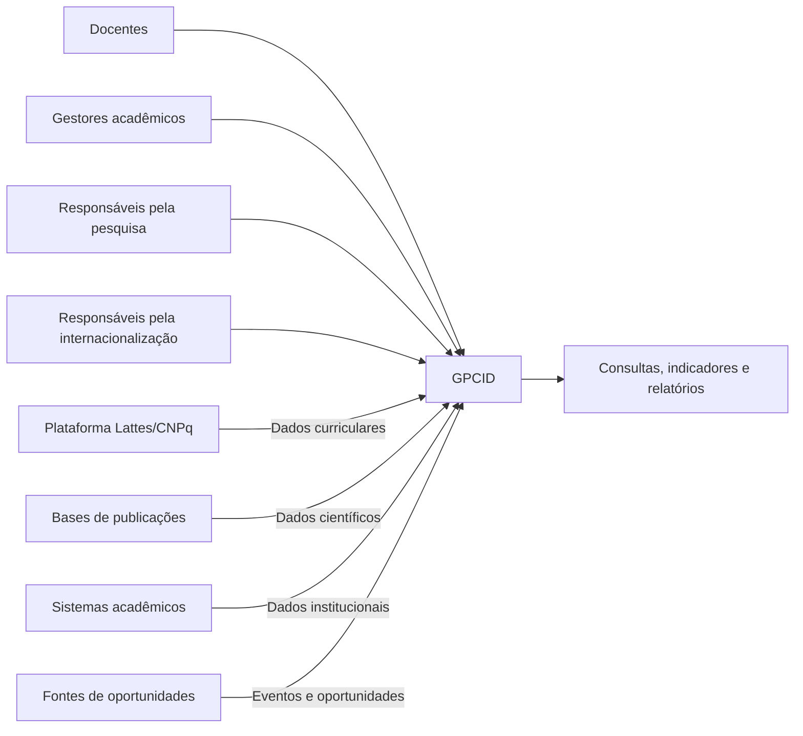
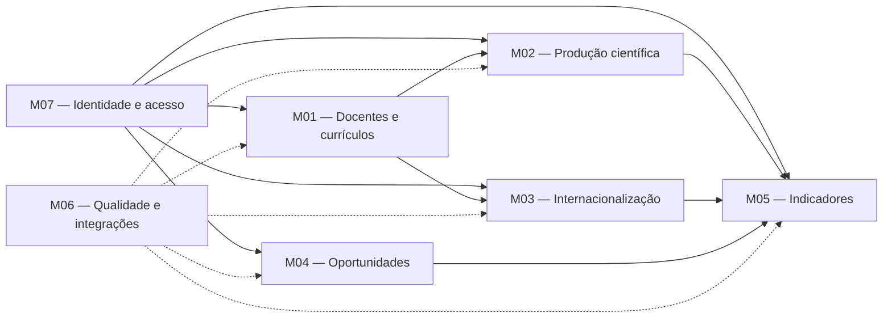

# Visão da Demanda (VD) — Gestão da Produção Científica e Internacionalização Docente (GPCID)

**Sistema de Gestão da Produção Científica e Internacionalização Docente — Universidade de Fortaleza (Unifor)**

> **Natureza:** proposta inicial de sistema, elaborada para apoiar a elicitação e a especificação de requisitos no processo LAPIS. As funcionalidades, prioridades, integrações, regras de negócio e indicadores apresentados constituem propostas preliminares e dependem de validação com os representantes institucionais.

## Identificação e Histórico

| Campo | Informação |
| --- | --- |
| Nome e identificador da demanda | Sistema de Gestão da Produção Científica e Internacionalização Docente — GPCID |
| Tipo | Novo sistema |
| Sistema ou produto relacionado | A definir — possíveis integrações com sistemas acadêmicos institucionais, Plataforma Lattes e bases de publicações científicas |
| Área solicitante | A definir — áreas responsáveis pela pesquisa científica e internacionalização da Unifor |
| Responsável pela elaboração | Equipe do projeto — integrantes a identificar |
| Responsável pela validação | Representantes institucionais das áreas responsáveis pela pesquisa e internacionalização — a identificar |
| Situação | Rascunho consolidado, em fase de elicitação |
| Versão e data | 1.1 — 08/11/2026 |

### Histórico de alterações

| Data | Versão | Descrição da alteração | Autor |
| --- | --- | --- | --- |
| 01/11/2026 | 1.0 | Criação inicial da Visão da Demanda com base na proposta 2 do Eixo I — Internacionalização. | Equipe do projeto |
| 08/11/2026 | 1.1 | Consolidação da visão com ampliação das funcionalidades de gestão curricular, produção científica, indicadores, oportunidades científicas, módulos funcionais e integrações potenciais. | Equipe do projeto |

## 1\. Objetivo

Desenvolver uma solução que permita organizar, consultar, acompanhar e analisar informações relacionadas à formação acadêmica, à produção científica e à atuação internacional dos docentes da Universidade de Fortaleza (Unifor).

O sistema pretende proporcionar uma visão integrada das informações acadêmicas e científicas dos docentes, contemplando currículos, titulações, publicações, colaborações científicas, missões internacionais e oportunidades de participação em eventos e atividades acadêmicas.

A solução deverá apoiar tanto os docentes, na consulta de informações relacionadas à própria trajetória acadêmica e científica, quanto os gestores institucionais, na identificação de competências, no acompanhamento da produção científica, na análise de indicadores e no planejamento de ações de internacionalização.

A proposta também considera a possibilidade de utilização de fontes externas autorizadas, como a Plataforma Lattes e bases de publicações científicas, reduzindo a necessidade de duplicação de informações já mantidas em sistemas oficiais.

## 2\. Contexto, Problema e Descrição Sumária da Demanda

### 2.1. Contexto e situação atual

A produção científica e a internacionalização docente representam dimensões importantes para o desenvolvimento acadêmico e institucional de uma universidade.

O acompanhamento dessas atividades envolve informações de diferentes naturezas e possíveis fontes, como:

-   Currículos acadêmicos dos docentes, incluindo formação, titulação e trajetória profissional.
-   Publicações científicas, artigos, livros, capítulos e trabalhos apresentados em eventos.
-   Informações sobre periódicos, editoras, instituições e países relacionados às produções.
-   Colaborações científicas e acadêmicas nacionais e internacionais.
-   Missões, visitas técnicas, intercâmbios acadêmicos e outras atividades internacionais.
-   Participação em congressos, seminários e oportunidades de publicação científica.
-   Indicadores relacionados à produção acadêmica e à internacionalização institucional.

Essas informações podem estar distribuídas entre plataformas externas, registros institucionais e documentos mantidos pelas próprias áreas responsáveis.

Entretanto, ainda é necessário investigar como a Unifor atualmente realiza o registro, a atualização, a consulta e a consolidação dessas informações.

A existência de sistemas institucionais ou mecanismos de acompanhamento deverá ser confirmada por meio de entrevistas e análise documental.

### 2.2. Problema ou oportunidade

A possível dispersão das informações acadêmicas e científicas pode dificultar a identificação de docentes com determinadas competências, a análise da produção científica, o acompanhamento das atividades internacionais e a consolidação de indicadores institucionais.

Além disso, a ausência de critérios padronizados de classificação e acompanhamento pode dificultar a comparação de resultados entre períodos, cursos e áreas de conhecimento.

A demanda representa uma oportunidade de desenvolver uma solução que centralize a consulta às informações, mantenha a rastreabilidade das fontes e permita análises mais consistentes sobre a atuação científica e internacional dos docentes.

### 2.3. Públicos afetados e impactos esperados

-   **Docentes:** poderão consultar informações relacionadas à formação, publicações, colaborações e atividades internacionais.
-   **Gestores acadêmicos:** poderão acompanhar informações consolidadas e utilizar indicadores no planejamento institucional.
-   **Responsáveis pela pesquisa científica:** poderão acompanhar a produção acadêmica, identificar publicações e analisar sua evolução.
-   **Responsáveis pela internacionalização:** poderão acompanhar atividades internacionais, identificar conexões acadêmicas e consultar oportunidades científicas.
-   **Equipe de tecnologia da informação:** poderá participar da avaliação das integrações, segurança, infraestrutura e sustentação da solução.

Os impactos específicos deverão ser confirmados durante a elicitação.

### 2.4. Evidências disponíveis

A proposta inicial tem como principal referência o documento institucional *Propostas de Projetos de Sistemas — Internacionalização e ENADE, semestre 2026.2*, especificamente a proposta 2 do Eixo I — Gestão da Produção Científica e Internacionalização Docente.

O documento apresenta a oportunidade de organizar e acompanhar informações relacionadas aos currículos, publicações, colaborações científicas e missões internacionais dos docentes.

As funcionalidades complementares de consulta histórica, classificação da internacionalização, indicadores configuráveis e oportunidades científicas são propostas de aprofundamento para investigação.

Não foram apresentadas evidências suficientes para confirmar a situação atual dos processos institucionais, a disponibilidade das fontes de dados ou a viabilidade das integrações.

### 2.5. Descrição sumária da demanda

Propor o desenvolvimento de um sistema para organizar informações sobre a formação acadêmica, a produção científica e a internacionalização dos docentes da Unifor.

A solução deverá possibilitar consultas aos currículos e publicações, acompanhamento de colaborações e missões internacionais, identificação de oportunidades científicas e disponibilização de indicadores e relatórios gerenciais.

Também deverá considerar mecanismos de controle de acesso, rastreabilidade das informações, atualização dos dados e integração com fontes externas autorizadas, conforme a viabilidade técnica e institucional.

## 3\. Proposta de Valor e Sucesso da Demanda

A solução busca proporcionar maior organização, transparência, acessibilidade e confiabilidade às informações relacionadas à produção científica e à internacionalização docente.

| Benefício esperado | Indicador ou evidência | Resultado desejado | Como e quando avaliar |
| --- | --- | --- | --- |
| Centralização das informações acadêmicas | Disponibilidade de informações curriculares e científicas em ambiente organizado. | Facilitar a localização e consulta das informações dos docentes. | Testes com usuários após a disponibilização da solução. |
| Melhoria do acompanhamento da produção científica | Disponibilidade de registros de publicações e indicadores por docente e período. | Permitir análises da produção acadêmica institucional. | Validação das consultas e relatórios com gestores. |
| Identificação de competências acadêmicas internacionais | Possibilidade de pesquisar formação, titulação, instituições e países. | Facilitar a identificação de docentes com experiências acadêmicas internacionais. | Testes de consulta com representantes institucionais. |
| Fortalecimento da internacionalização docente | Disponibilidade de informações sobre missões, colaborações e atividades internacionais. | Facilitar o acompanhamento das atividades internacionais. | Avaliação com a área responsável pela internacionalização. |
| Apoio à cooperação científica | Disponibilidade de informações sobre colaborações e oportunidades acadêmicas. | Apoiar a identificação de possibilidades de cooperação. | Avaliação com gestores e pesquisadores. |
| Apoio à tomada de decisão | Disponibilidade de indicadores e relatórios consolidados. | Oferecer subsídios para o planejamento institucional. | Homologação dos indicadores e relatórios. |
| Melhoria da qualidade dos dados | Registros com origem, data de atualização e identificação de inconsistências. | Aumentar a confiabilidade das informações utilizadas nas análises. | Auditorias e verificações periódicas. |

**Observação:** Não foram estabelecidas metas quantitativas porque não existem dados de linha de base disponíveis. Os indicadores e resultados desejados deverão ser refinados com os interessados.

## 4\. Partes Interessadas

| Parte interessada | Papel e interesse | Responsabilidade | Representante |
| --- | --- | --- | --- |
| Universidade de Fortaleza (Unifor) | Instituição beneficiária da solução. | Definir diretrizes institucionais e autorizar o desenvolvimento e utilização do sistema. | A definir |
| Área responsável pela internacionalização | Interessada no acompanhamento das atividades internacionais dos docentes. | Validar necessidades, indicadores e informações relacionadas à internacionalização. | A definir |
| Área responsável pela pesquisa científica | Interessada na organização e análise da produção científica. | Validar informações, critérios de classificação e indicadores acadêmicos. | A definir |
| Docentes | Beneficiários e possíveis usuários do sistema. | Consultar e, caso aprovado, complementar ou validar informações relacionadas à própria atuação acadêmica. | Comunidade docente |
| Gestores acadêmicos | Interessados nas informações consolidadas. | Identificar necessidades gerenciais e validar relatórios e indicadores. | A definir |
| Equipe de desenvolvimento | Responsável pela construção da solução. | Elicitar, especificar, implementar e testar os requisitos aprovados. | Equipe do projeto |
| Equipe de tecnologia da informação | Responsável pelo suporte técnico e avaliação das integrações. | Avaliar infraestrutura, segurança, autenticação, integrações e manutenção. | A definir |
| Responsáveis pela proteção de dados | Interessados na conformidade do tratamento das informações. | Avaliar questões relacionadas à privacidade, permissões e proteção de dados. | A definir |

## 5\. Usuários e Atores Externos

Os perfis apresentados são propostas iniciais e deverão ser confirmados durante a elicitação.

| ID | Usuário, sistema ou dispositivo | Objetivo ou papel na interação | Contexto de uso relevante |
| --- | --- | --- | --- |
| AT-01 | Docente | Consultar informações sobre sua formação, currículo, publicações e atividades internacionais. | Necessita de acesso organizado às informações acadêmicas. |
| AT-02 | Gestor de internacionalização | Acompanhar indicadores, missões, colaborações e atividades internacionais. | Utiliza informações para planejamento e acompanhamento institucional. |
| AT-03 | Analista de internacionalização | Consultar, organizar e eventualmente validar registros relacionados às atividades internacionais. | Atua no acompanhamento e na organização das informações. |
| AT-04 | Gestor ou responsável pela pesquisa científica | Acompanhar publicações, currículos e indicadores de produção científica. | Necessita de informações confiáveis e atualizadas. |
| AT-05 | Administrador do sistema | Administrar usuários, permissões, parâmetros e configurações. | Atua na manutenção funcional e administrativa. |
| AT-06 | Gestor acadêmico | Consultar informações consolidadas por curso, unidade ou período. | Utiliza informações para análises e decisões acadêmicas. |
| AT-07 | Plataforma Lattes / CNPq | Possível fonte externa de informações curriculares e acadêmicas. | Acesso e mecanismos de integração deverão ser investigados. |
| AT-08 | Bases de publicações científicas | Possíveis fontes de informações sobre artigos, livros e demais produções. | Fontes e mecanismos de acesso a definir. |
| AT-09 | Sistemas acadêmicos institucionais | Possíveis fontes de informações sobre docentes, cursos e vínculos. | Integração condicionada à autorização e viabilidade técnica. |
| AT-10 | Fontes externas de oportunidades científicas | Possíveis fontes de congressos, eventos e oportunidades de publicação. | Disponibilidade e integração a investigar. |

**Observação:** Os atores externos representam fontes potenciais. Sua participação definitiva dependerá da confirmação de mecanismos autorizados de acesso e integração.

## 6\. Escopo e Entregas Previstas

### 6.1. Incluído na demanda

Considerando a proposta institucional e os aprofundamentos apresentados, estão previstas para investigação e possível inclusão no produto:

-   Organização e consulta das informações curriculares dos docentes.
-   Consulta à formação acadêmica, titulação, instituições e países relacionados à trajetória acadêmica.
-   Organização e acompanhamento de artigos, livros, capítulos e demais produções científicas.
-   Pesquisa de publicações por docente, tipo, ano, periódico, editora e outros critérios.
-   Identificação e classificação de características relacionadas à internacionalização da produção científica.
-   Consulta ao histórico da produção acadêmica e sua evolução por período.
-   Organização e acompanhamento de colaborações científicas e acadêmicas.
-   Registro e acompanhamento de missões e atividades internacionais.
-   Consulta a oportunidades científicas, congressos e eventos acadêmicos, caso essa necessidade seja validada.
-   Disponibilização de indicadores relacionados à produção científica e internacionalização.
-   Geração de relatórios e exportação de informações autorizadas.
-   Identificação e acompanhamento de inconsistências nas informações.
-   Definição de mecanismos de atualização, origem e rastreabilidade dos dados.
-   Controle de acesso conforme os perfis e responsabilidades institucionais.

A confirmação dessas capacidades e a definição do produto mínimo viável dependerão da elicitação e priorização com os interessados.

### 6.2. Fora do escopo

Inicialmente, não estão previstas:

-   Substituição da Plataforma Lattes ou de outras fontes oficiais de currículos.
-   Alteração direta de informações curriculares nas plataformas externas.
-   Gestão completa de contratação, avaliação funcional ou progressão na carreira docente.
-   Gestão financeira de projetos, bolsas e recursos de internacionalização.
-   Gerenciamento de inscrições e processos seletivos de mobilidade estudantil.
-   Produção ou submissão automática de artigos científicos em periódicos.
-   Gestão de processos acadêmicos de estudantes.
-   Gestão completa de convênios e contratos internacionais.
-   Garantia de integração com plataformas externas sem autorização e viabilidade técnica comprovadas.

### 6.3. Evoluções futuras

-   Identificação de oportunidades de colaboração entre docentes e pesquisadores estrangeiros.
-   Análise de redes de coautoria e colaboração científica.
-   Identificação de potenciais parceiros internacionais.
-   Comparação da produção científica entre cursos, centros e áreas.
-   Acompanhamento de metas institucionais de internacionalização.
-   Ampliação das fontes de dados científicos e acadêmicos.
-   Notificações automáticas sobre necessidade de atualização de currículos.
-   Painéis analíticos avançados para planejamento institucional.
-   Acompanhamento de convênios e parcerias internacionais.

Essas possibilidades não representam compromisso de implementação na primeira versão.

### 6.4. Entregas e marcos

| Entrega ou marco | Resultado previsto | Condição |
| --- | --- | --- |
| Elicitação dos requisitos | Identificação e validação das necessidades, atores e funcionalidades. | Durante o levantamento com os interessados. |
| Visão da Demanda | Consolidação do problema, objetivos, escopo e catálogo inicial. | Após revisão e validação institucional. |
| Regras de negócio | Documentação dos critérios de classificação e políticas institucionais. | Após levantamento com as áreas responsáveis. |
| Especificação dos requisitos | Documentação dos casos de uso e requisitos de qualidade. | Após validação da visão. |
| Modelagem e prototipação | Representação das interações e telas principais. | Após definição inicial dos requisitos. |
| Desenvolvimento e testes | Construção e verificação das funcionalidades priorizadas. | Conforme planejamento aprovado. |
| Validação da solução | Avaliação com usuários e representantes institucionais. | Após disponibilização de versão para avaliação. |

## 7\. Necessidades e Catálogo de Funcionalidades

### 7.1. Catálogo de necessidades

As necessidades abaixo consolidam as propostas dos dois documentos. Ainda precisam ser investigadas e validadas com os usuários.

| ID | Necessidade | Fonte ou evidência | Atores relacionados |
| --- | --- | --- | --- |
| NEC-01 | Organizar e consultar informações curriculares e vínculos institucionais dos docentes. | Proposta institucional — Eixo I, proposta 2. | AT-01, AT-02, AT-04, AT-06, AT-07, AT-09 |
| NEC-02 | Consultar formação acadêmica, titulação e trajetória dos docentes. | Aprofundamento da proposta de gestão da produção científica. | AT-01, AT-02, AT-04, AT-06 |
| NEC-03 | Acompanhar publicações e demais produções científicas dos docentes. | Proposta institucional — Eixo I, proposta 2. | AT-01, AT-02, AT-04, AT-08 |
| NEC-04 | Identificar e acompanhar características de internacionalização das produções científicas. | Aprofundamento da proposta de internacionalização docente. | AT-02, AT-03, AT-04, AT-06 |
| NEC-05 | Acompanhar colaborações científicas e acadêmicas. | Proposta institucional — Eixo I, proposta 2. | AT-01, AT-02, AT-03, AT-04 |
| NEC-06 | Organizar e acompanhar missões e atividades internacionais dos docentes. | Proposta institucional — Eixo I, proposta 2. | AT-01, AT-02, AT-03 |
| NEC-07 | Consultar oportunidades científicas, congressos e eventos acadêmicos. | Proposta complementar a validar. | AT-01, AT-02, AT-03, AT-10 |
| NEC-08 | Disponibilizar indicadores, consultas e relatórios sobre produção científica e internacionalização. | Proposta institucional e aprofundamento analítico. | AT-02, AT-03, AT-04, AT-06 |
| NEC-09 | Identificar inconsistências e garantir a rastreabilidade e qualidade das informações. | Necessidade transversal identificada na análise inicial. | AT-02, AT-03, AT-04, AT-05, AT-07, AT-08 |
| NEC-10 | Controlar usuários e permissões de acesso às informações. | Necessidade transversal relacionada à segurança e privacidade. | AT-01, AT-02, AT-03, AT-04, AT-05, AT-06 |

### 7.2. Catálogo de funcionalidades

| ID | Funcionalidade e resultado esperado | Necessidade | Atores (IDs) | Prioridade proposta | Especificação |
| --- | --- | --- | --- | --- | --- |
| F-01 | Consultar informações curriculares dos docentes, permitindo visualizar dados acadêmicos organizados. | NEC-01 | AT-01, AT-02, AT-04, AT-06 | Essencial | CDU-01 |
| F-02 | Identificar e consultar formação acadêmica, titulação, instituições e países relacionados à trajetória dos docentes. | NEC-02 | AT-01, AT-02, AT-04, AT-06 | Essencial | CDU-02 |
| F-03 | Organizar e consultar publicações científicas por docente, tipo, ano, periódico e editora. | NEC-03 | AT-01, AT-02, AT-04 | Essencial | CDU-03 |
| F-04 | Classificar características de internacionalização das produções científicas conforme critérios institucionais definidos. | NEC-04 | AT-02, AT-03, AT-04 | Essencial | CDU-04 |
| F-05 | Consultar o histórico e a evolução da produção científica por período e critérios institucionais. | NEC-03, NEC-08 | AT-02, AT-04, AT-06 | Essencial | CDU-05 |
| F-06 | Consultar informações sobre colaborações científicas e acadêmicas. | NEC-05 | AT-01, AT-02, AT-03, AT-04 | Importante | CDU-06 |
| F-07 | Registrar e consultar missões e atividades internacionais dos docentes. | NEC-06 | AT-01, AT-02, AT-03 | Essencial | CDU-07 |
| F-08 | Consultar oportunidades científicas, congressos e eventos acadêmicos. | NEC-07 | AT-01, AT-02, AT-03 | Desejável | CDU-08 |
| F-09 | Cadastrar e atualizar manualmente oportunidades científicas, caso essa necessidade seja confirmada. | NEC-07 | AT-02, AT-03 | Desejável | CDU-09 |
| F-10 | Consultar indicadores da produção científica e internacionalização. | NEC-08 | AT-02, AT-03, AT-04, AT-06 | Essencial | CDU-10 |
| F-11 | Gerar relatórios consolidados e exportar informações autorizadas. | NEC-08 | AT-02, AT-03, AT-04, AT-06 | Essencial | CDU-11 |
| F-12 | Configurar indicadores por meio de medidas, filtros, agrupamentos e critérios previamente disponibilizados. | NEC-08 | AT-02 | Importante | CDU-12 |
| F-13 | Manter definições e versões dos indicadores, preservando critérios e histórico de alterações. | NEC-08, NEC-09 | AT-02 | Importante | CDU-13 |
| F-14 | Identificar informações incompletas, duplicadas ou inconsistentes. | NEC-09 | AT-02, AT-03, AT-04, AT-05 | Importante | CDU-14 |
| F-15 | Registrar a origem, a data de atualização e o histórico de obtenção das informações. | NEC-09 | AT-02, AT-03, AT-05 | Essencial | CDU-15 |
| F-16 | Administrar usuários e permissões de acesso conforme os perfis institucionais. | NEC-10 | AT-05 | Essencial | CDU-16 |
| F-17 | Consultar informações de atualização e falhas relacionadas às possíveis integrações externas. | NEC-09, NEC-10 | AT-05 | Importante | CDU-17 |

**Observações sobre o catálogo:**

-   As prioridades são classificações preliminares e deverão ser confirmadas pelos interessados.
-   As funcionalidades F-08 e F-09 representam uma ampliação da proposta original e dependem de confirmação da necessidade de gestão de oportunidades científicas.
-   A configuração e o versionamento de indicadores são propostas de aprofundamento e não representam uma decisão institucional aprovada.
-   A integração automática com o Currículo Lattes e bases de publicações não está confirmada.
-   A correção de informações curriculares deverá ocorrer prioritariamente na fonte oficial, caso seja adotada uma estratégia de importação somente para leitura.
-   Os casos de uso CDU-01 a CDU-17 deverão ser elaborados e detalhados durante a especificação.

### 7.3. Rastreabilidade inicial

| Fonte/evidência | Necessidade | Funcionalidade | Especificação |
| --- | --- | --- | --- |
| Proposta institucional — Eixo I, proposta 2 | NEC-01 | F-01 | CDU-01 |
| Aprofundamento da proposta de gestão curricular | NEC-02 | F-02 | CDU-02 |
| Proposta institucional — Eixo I, proposta 2 | NEC-03 | F-03 e F-05 | CDU-03 e CDU-05 |
| Aprofundamento da internacionalização científica | NEC-04 | F-04 | CDU-04 |
| Proposta institucional — Eixo I, proposta 2 | NEC-05 | F-06 | CDU-06 |
| Proposta institucional — Eixo I, proposta 2 | NEC-06 | F-07 | CDU-07 |
| Proposta complementar a validar | NEC-07 | F-08 e F-09 | CDU-08 e CDU-09 |
| Proposta institucional e aprofundamento analítico | NEC-08 | F-10, F-11, F-12 e F-13 | CDU-10 a CDU-13 |
| Necessidade transversal | NEC-09 | F-14 e F-15 | CDU-14 e CDU-15 |
| Necessidade transversal | NEC-10 | F-16 e F-17 | CDU-16 e CDU-17 |

A rastreabilidade deverá ser complementada com entrevistas, observações, documentos institucionais, regras de negócio e critérios de aceitação.

### 7.4. Proposta inicial de indicadores

A solução poderá disponibilizar indicadores predefinidos para acompanhamento da produção científica e internacionalização.

Os indicadores abaixo representam exemplos para discussão e não critérios institucionais já homologados.

| ID | Indicador proposto | Medida | Recortes sugeridos |
| --- | --- | --- | --- |
| IND-01 | Docentes com formação acadêmica no exterior | Quantidade de docentes distintos | Curso, nível de titulação, país e período |
| IND-02 | Publicações em periódicos estrangeiros | Quantidade de artigos distintos | Ano, curso, docente e país do periódico |
| IND-03 | Livros e capítulos publicados por editoras estrangeiras | Quantidade de obras distintas | Ano, curso, tipo e país da editora |
| IND-04 | Participação em eventos científicos internacionais | Quantidade de participações registradas | Ano, curso, modalidade e país |
| IND-05 | Evolução anual da produção científica | Quantidade de produções distintas | Curso, tipo de produção e período |
| IND-06 | Missões internacionais realizadas | Quantidade de registros de missões | Docente, país, instituição e período |
| IND-07 | Colaborações científicas internacionais | Quantidade de colaborações identificadas | Docente, país, instituição e período |
| IND-08 | Oportunidades científicas disponíveis | Quantidade de oportunidades vigentes | Área, país, modalidade e prazo |
| IND-09 | Cobertura e qualidade dos dados curriculares | Percentual de registros com informações completas e atualizadas | Curso e ciclo de atualização |

**Cuidados metodológicos:**

-   Diferenciar o país de publicação, o idioma do trabalho e a afiliação dos autores.
-   Não considerar automaticamente uma publicação internacional apenas por estar escrita em idioma estrangeiro.
-   Definir critérios para distinguir publicações nacionais e internacionais.
-   Evitar contagem duplicada de publicações compartilhadas por diferentes docentes.
-   Identificar registros sem informações suficientes para classificação.
-   Definir se os indicadores considerarão toda a trajetória acadêmica ou somente produções realizadas durante o vínculo com a Unifor.
-   Informar a fonte e a data de atualização dos dados utilizados.

### 7.5. Proposta de gestão dos indicadores

Caso seja validada a necessidade de indicadores configuráveis, recomenda-se que cada indicador possua:

-   Identificador e nome.
-   Objetivo e descrição.
-   Medida e unidade de cálculo.
-   População ou conjunto de dados considerado.
-   Regras de inclusão e exclusão.
-   Fontes utilizadas.
-   Periodicidade e data de referência.
-   Filtros e agrupamentos permitidos.
-   Critérios de deduplicação.
-   Tratamento de dados incompletos.
-   Responsável pela definição e validação.
-   Situação e versão do indicador.

A configuração poderá ocorrer por uma interface guiada, sem necessidade de permitir fórmulas ou consultas SQL livres.

O fluxo proposto seria:

1.  Selecionar ou criar um indicador.
2.  Informar sua finalidade e medida.
3.  Selecionar o conjunto de dados e período.
4.  Definir filtros e agrupamentos.
5.  Configurar critérios de cálculo disponíveis.
6.  Visualizar uma prévia do resultado.
7.  Salvar a definição e submetê-la à validação.
8.  Ativar a versão aprovada.
9.  Consultar os resultados e preservar o histórico metodológico.

A responsabilidade pela criação, aprovação e publicação dos indicadores deverá ser definida com os gestores institucionais.

## 8\. Visão Geral da Solução e Impactos

A solução proposta consiste em um sistema de apoio à gestão da produção científica e internacionalização docente, destinado a organizar informações acadêmicas e científicas e disponibilizar recursos de consulta, acompanhamento e análise.

O sistema deverá permitir uma visão consolidada da trajetória acadêmica dos docentes, contemplando formação, publicações, colaborações, missões internacionais e indicadores relacionados às atividades científicas.

### 8.1. Responsabilidades da solução

-   Organizar informações sobre currículos e trajetórias acadêmicas.
-   Disponibilizar consultas às publicações científicas dos docentes.
-   Permitir a análise de características de internacionalização da produção.
-   Apoiar o acompanhamento de colaborações científicas.
-   Permitir o registro e acompanhamento de missões internacionais.
-   Disponibilizar indicadores e relatórios gerenciais.
-   Identificar possíveis inconsistências nas informações.
-   Registrar a origem e a atualização dos dados.
-   Controlar o acesso conforme os perfis autorizados.

### 8.2. Sistemas e dispositivos externos

**Plataforma Lattes/CNPq**

Possível fonte de informações curriculares e acadêmicas dos docentes. A disponibilidade de mecanismos autorizados de consulta ou extração deverá ser investigada.

**Bases de publicações científicas**

Possíveis fontes de informações sobre artigos, periódicos, livros, capítulos e outras produções. As fontes específicas ainda deverão ser identificadas.

**Sistemas acadêmicos institucionais**

Possíveis fontes de informações cadastrais dos docentes, vínculos, cursos e unidades acadêmicas.

**Fontes de oportunidades científicas**

Possíveis fontes de informações sobre congressos, eventos, chamadas para publicação e oportunidades acadêmicas.

**Usuários da solução**

Docentes, gestores e responsáveis institucionais que utilizarão o sistema para consultar e acompanhar informações conforme suas permissões.

### 8.3. Integrações principais

As integrações representam possibilidades a investigar:

-   Obtenção ou atualização de informações curriculares a partir de fontes autorizadas.
-   Consulta ou importação de publicações científicas.
-   Obtenção de informações cadastrais e vínculos dos docentes.
-   Consulta a informações sobre eventos e oportunidades científicas.
-   Disponibilização de informações consolidadas para consultas e relatórios.
-   Possível utilização de autenticação institucional.

A arquitetura, os protocolos e os contratos de integração deverão ser definidos após avaliação de viabilidade.

### 8.4. Diagrama de contexto — representação conceitual

mermaid

O diagrama representa relações conceituais possíveis. Não estabelece integrações aprovadas ou decisões de arquitetura.

### 8.5. Decomposição funcional em módulos

Para facilitar a organização da solução e a distribuição dos casos de uso durante a especificação, propõe-se a seguinte divisão lógica:

| Módulo | Responsabilidade | Funcionalidades | Atores principais |
| --- | --- | --- | --- |
| M01 — Docentes e Currículos | Organização e consulta de informações curriculares, formação e trajetória acadêmica. | F-01 e F-02 | Docentes, gestores e responsáveis pela pesquisa |
| M02 — Produção Científica | Consulta de publicações, classificação de internacionalização e histórico da produção. | F-03, F-04 e F-05 | Docentes, gestores e responsáveis pela pesquisa |
| M03 — Colaboração e Internacionalização | Acompanhamento de colaborações e missões internacionais. | F-06 e F-07 | Docentes, gestores e responsáveis pela internacionalização |
| M04 — Oportunidades Científicas | Consulta e eventual cadastro de congressos e oportunidades. | F-08 e F-09 | Gestores, analistas e docentes |
| M05 — Indicadores e Relatórios | Consultas gerenciais, indicadores, configuração e versionamento. | F-10, F-11, F-12 e F-13 | Gestores e responsáveis institucionais |
| M06 — Qualidade e Integrações | Identificação de inconsistências, rastreabilidade, atualização e monitoramento. | F-14, F-15 e F-17 | Administradores e responsáveis institucionais |
| M07 — Identidade e Controle de Acesso | Administração de usuários e permissões. | F-16 | Administrador do sistema |

A divisão é lógica e não implica aplicações independentes ou microsserviços.

### 8.6. Mapa de dependências entre módulos

mermaid

O mapa demonstra dependências conceituais. Os relacionamentos funcionais deverão ser refinados durante a especificação.

### 8.7. Representações visuais futuras

-   Diagrama geral de casos de uso.
-   Diagramas de casos de uso por módulo.
-   Protótipos de baixa fidelidade das telas de consulta e acompanhamento.
-   Modelo conceitual dos dados acadêmicos e científicos.
-   Diagramas de componentes e integração, em documentação técnica específica.

## 9\. Condições Gerais da Demanda

| Tipo | Condição e impacto na demanda | Responsável ou fonte | Situação |
| --- | --- | --- | --- |
| Premissa | A solução deverá apoiar os processos institucionais de acompanhamento da produção científica e internacionalização docente. | Proposta institucional. | A confirmar |
| Premissa | Os dados utilizados deverão possuir origem identificável. | Áreas responsáveis pelos dados. | A validar |
| Premissa | As informações deverão ser atualizadas conforme periodicidade definida pelos interessados. | Gestores institucionais. | A definir |
| Restrição | O acesso às fontes externas dependerá das condições de utilização, disponibilidade e autorização dos responsáveis. | Fontes externas e instituição. | Aplicável |
| Restrição | O sistema não deverá substituir plataformas oficiais de currículos e publicações. | Diretriz proposta para a solução. | A validar |
| Restrição | O tratamento de dados pessoais deverá observar a legislação aplicável, especialmente a LGPD. | Instituição e responsáveis pela proteção de dados. | Aplicável |
| Dependência | A obtenção de informações curriculares dependerá da disponibilidade de mecanismos autorizados. | Responsáveis pelas fontes e equipe técnica. | A investigar |
| Dependência | A definição dos indicadores dependerá da validação dos critérios institucionais. | Gestores acadêmicos. | A definir |
| Dependência | A disponibilização de informações institucionais dependerá de autorização das áreas responsáveis. | Universidade de Fortaleza. | A confirmar |
| Qualidade | As informações deverão apresentar consistência, rastreabilidade e atualização adequada. | Equipe de desenvolvimento e áreas responsáveis. | A especificar |
| Qualidade | A solução deverá oferecer mecanismos adequados de controle de acesso e proteção das informações. | Instituição e equipe de TI. | A especificar |
| Qualidade | Consultas e relatórios deverão apresentar informações compreensíveis e organizadas. | Usuários e equipe de desenvolvimento. | A especificar |

## 10\. Riscos e Questões em Aberto

| ID | Tipo | Risco ou questão | Impacto | Próxima ação | Situação |
| --- | --- | --- | --- | --- | --- |
| PQ-01 | Dúvida | Quais áreas serão responsáveis pela utilização, validação e aprovação da solução? | Pode comprometer a definição dos responsáveis e do escopo. | Identificar representantes institucionais. | Aberto |
| PQ-02 | Risco | Não existir mecanismo autorizado ou tecnicamente viável para obtenção automática dos dados do Lattes. | Pode exigir atualização manual ou outra estratégia de obtenção dos dados. | Investigar condições de acesso ao Lattes Extrator. | Aberto |
| PQ-03 | Dúvida | Quais bases de publicações científicas deverão ser utilizadas? | Pode afetar a abrangência das informações. | Consultar pesquisadores e gestores. | Aberto |
| PQ-04 | Dúvida | Qual será a periodicidade de atualização dos currículos e publicações? | Pode comprometer a atualidade dos indicadores. | Validar periodicidade e responsabilidades. | Aberto |
| PQ-05 | Risco | Existência de dados incompletos, duplicados ou inconsistentes. | Pode comprometer a confiabilidade dos relatórios. | Definir critérios de validação e deduplicação. | Aberto |
| PQ-06 | Dúvida | Quais critérios definirão a classificação de uma produção como internacional? | Pode gerar indicadores inconsistentes. | Elaborar e validar regras de negócio. | Aberto |
| PQ-07 | Dúvida | Quais indicadores serão considerados relevantes e oficiais? | Pode comprometer a utilidade das análises. | Realizar levantamento com gestores. | Aberto |
| PQ-08 | Dúvida | Quais perfis poderão consultar, cadastrar, alterar e administrar informações? | Pode afetar a segurança e a privacidade. | Levantar responsabilidades e permissões. | Aberto |
| PQ-09 | Risco | O tratamento das informações poderá envolver restrições legais e institucionais. | Pode limitar o acesso e a divulgação de determinados dados. | Consultar responsáveis por proteção de dados e jurídico. | Aberto |
| PQ-10 | Dúvida | Os docentes poderão atualizar diretamente informações no sistema ou apenas consultar dados externos? | Pode alterar o escopo e a responsabilidade pela manutenção. | Validar com docentes e gestores. | Aberto |
| PQ-11 | Dúvida | Quais informações deverão ser registradas sobre missões internacionais? | Pode comprometer a definição dos dados e relatórios. | Entrevistar responsáveis pela internacionalização. | Aberto |
| PQ-12 | Dúvida | Será necessário manter um catálogo de congressos e oportunidades científicas? | Pode ampliar significativamente o escopo funcional. | Validar a necessidade com os interessados. | Aberto |
| PQ-13 | Dúvida | A solução deverá permitir configuração de indicadores ou apenas disponibilizar indicadores predefinidos? | Pode afetar a complexidade da solução. | Validar com os gestores. | Aberto |
| PQ-14 | Risco | Não haver integração disponível com os sistemas acadêmicos institucionais. | Pode exigir cadastro ou atualização alternativa dos dados. | Avaliar possibilidades técnicas com TI. | Aberto |
| PQ-15 | Dúvida | Como deverão ser tratados docentes inativos e produções anteriores ao vínculo institucional? | Pode comprometer a interpretação dos indicadores. | Definir critérios temporais e institucionais. | Aberto |

As questões deverão ser acompanhadas durante a elicitação. Suas respostas deverão ser incorporadas às respectivas seções da VD e registradas no histórico de alterações.

## 11\. Documentos Relacionados

| Documento | Conteúdo sob sua responsabilidade | Referência e situação |
| --- | --- | --- |
| Documento de propostas de projetos — Internacionalização e ENADE | Contexto inicial e descrição da oportunidade de projeto. | Eixo I, proposta 2 — disponível. |
| Regras de negócio compartilhadas | Políticas de classificação, acompanhamento e gestão das informações. | A elaborar. |
| Requisitos não funcionais ou de qualidade | Segurança, privacidade, desempenho, disponibilidade, usabilidade e integridade. | A elaborar. |
| Arquitetura e contratos de integração | Definições técnicas e contratos de comunicação com fontes externas. | A elaborar após análise de viabilidade. |
| Glossário | Definições dos principais termos acadêmicos, científicos e de internacionalização. | A elaborar. |
| Casos de uso | Fluxos, atores, precondições, exceções e critérios de aceitação. | CDU-01 a CDU-17 — a elaborar. |
| Catálogo de indicadores | Definições, medidas, regras de cálculo, fontes e periodicidade. | A elaborar após validação institucional. |
| Legislação de proteção de dados | Referência legal para tratamento de dados pessoais. | Lei nº 13.709/2018 — LGPD. |

## 12\. Validação da Visão

### 12.1. Checklist

-   [x] Objetivo, contexto e oportunidade estão apresentados.
-   [x] Benefícios e condições de sucesso estão descritos.
-   [x] Ausência de metas quantitativas e linha de base está identificada.
-   [ ] Responsáveis institucionais por decisões e validação estão identificados nominalmente.
-   [x] Usuários e atores externos potenciais estão representados.
-   [x] Escopo, exclusões e evoluções futuras estão diferenciados.
-   [x] Necessidades possuem identificadores e fontes ou justificativas.
-   [x] Funcionalidades possuem identificadores, atores, prioridades preliminares e referências à especificação futura.
-   [x] Indicadores preliminares foram apresentados com ressalvas metodológicas.
-   [x] Integrações e dependências externas foram identificadas sem serem tratadas como confirmadas.
-   [x] Visão geral da solução e decomposição modular foram apresentadas.
-   [x] Representação conceitual de contexto e dependências incluída.
-   [x] Premissas, restrições, dependências e riscos foram registrados.
-   [x] Documentos relacionados e artefatos pendentes foram identificados.
-   [ ] Prioridades e funcionalidades foram validadas pelos interessados.
-   [ ] Responsáveis institucionais revisaram e confirmaram o conteúdo.

### 12.2. Critérios de conclusão e encaminhamento

**Condição atual: rascunho consolidado, com pendências de validação institucional.**

A versão 1.1 consolida a proposta inicial de gestão da produção científica e internacionalização docente com possibilidades adicionais de acompanhamento curricular, classificação da internacionalização, indicadores configuráveis e oportunidades científicas.

O documento apresenta uma visão mais abrangente da solução, mas ainda não representa aprovação institucional das funcionalidades, prioridades ou integrações.

Para avançar à especificação dos requisitos, será necessário:

-   Identificar e consultar representantes das áreas responsáveis pela pesquisa científica e internacionalização.
-   Investigar os processos atualmente utilizados pela Universidade.
-   Confirmar os perfis de usuários e suas responsabilidades.
-   Validar as necessidades e funcionalidades propostas.
-   Definir o produto mínimo viável e as prioridades.
-   Estabelecer critérios de classificação da internacionalização científica.
-   Validar os indicadores e suas regras de cálculo.
-   Investigar a disponibilidade das fontes de dados e mecanismos de integração.
-   Esclarecer as responsabilidades de atualização e manutenção das informações.
-   Validar as condições de acesso, segurança e privacidade.

A condição de visão validada dependerá da confirmação formal do entendimento geral, dos limites da demanda e das prioridades pelos representantes institucionais responsáveis.

### 12.3. Registro da validação

| Versão | Responsável e papel | Data | Condição da VD | Resultado e ressalvas |
| --- | --- | --- | --- | --- |
| 1.0 | Equipe do projeto — elaboração inicial | 01/11/2026 | Rascunho | Elaborada com base na proposta institucional. |
| 1.1 | Equipe do projeto — consolidação da visão | 08/11/2026 | Rascunho consolidado | Ampliação do escopo conceitual e do catálogo de funcionalidades. Necessita de elicitação e validação institucional. |

**Nota:** A elaboração deste documento não representa aprovação institucional da demanda nem confirmação de que as funcionalidades, regras de negócio ou integrações propostas serão implementadas. A validação deverá ocorrer com os representantes responsáveis, conforme o processo LAPIS.